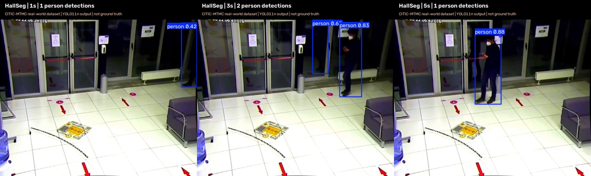
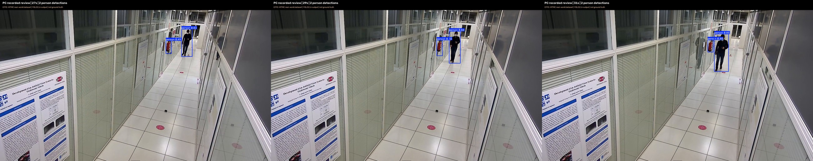
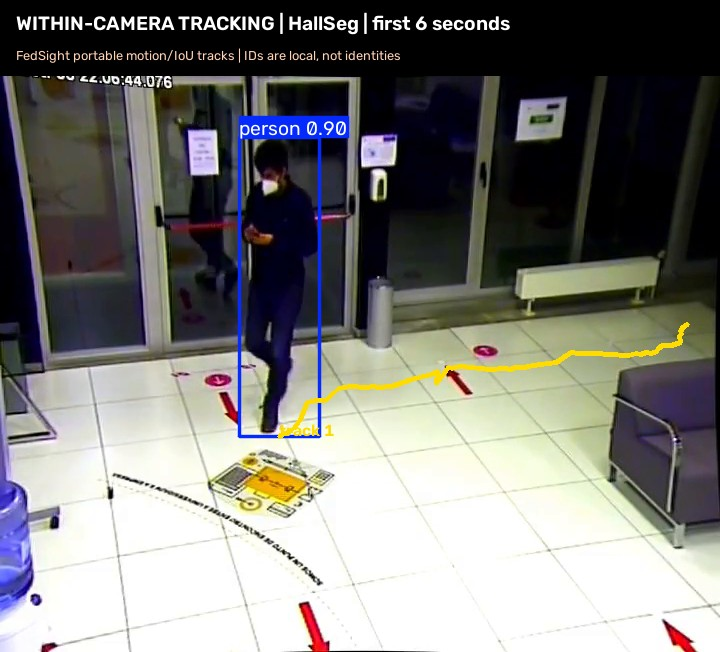
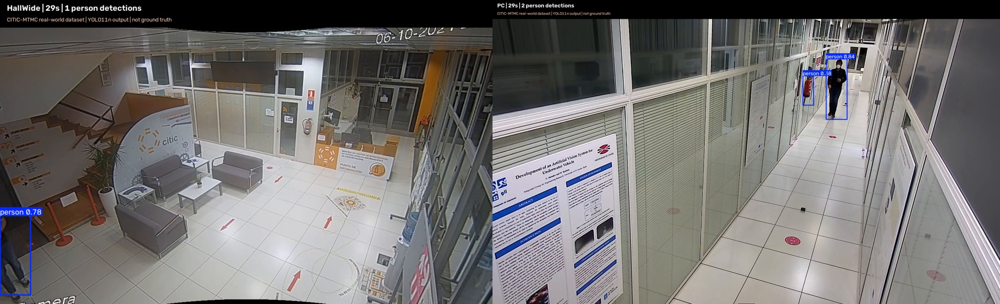
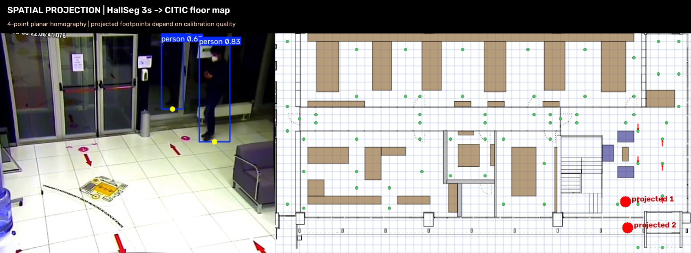
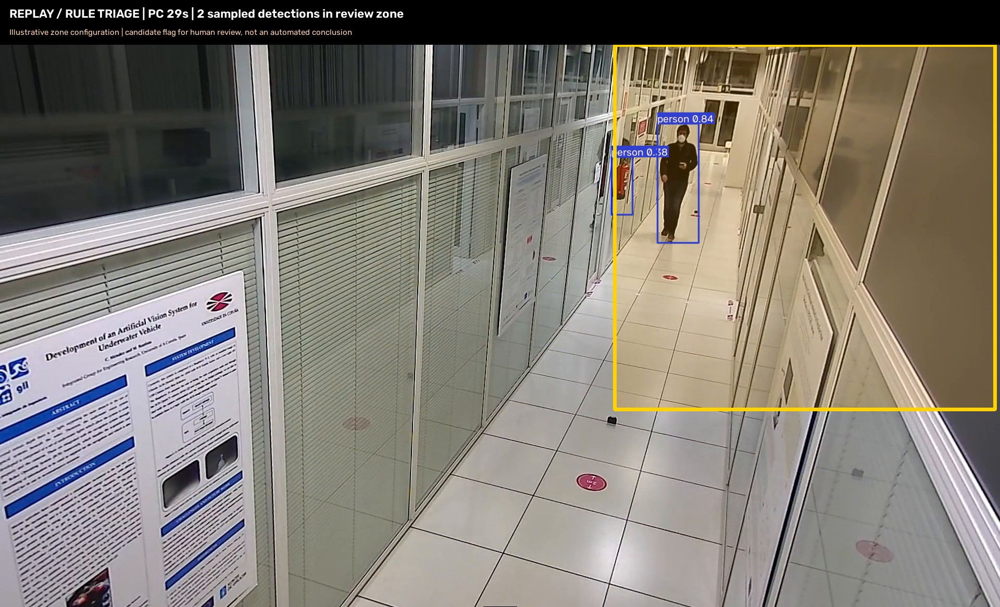
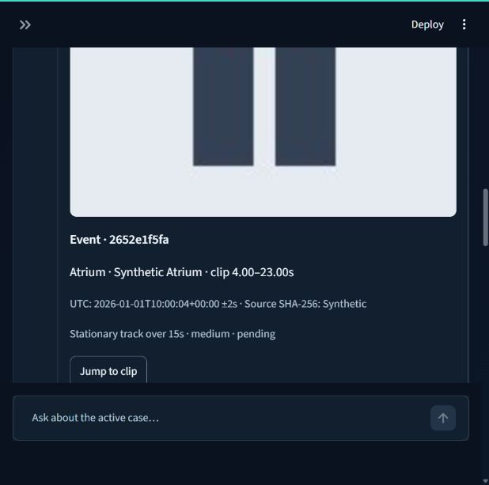
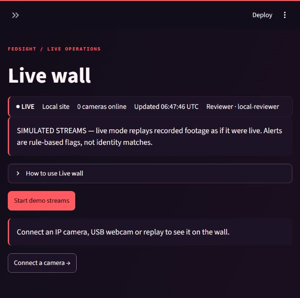
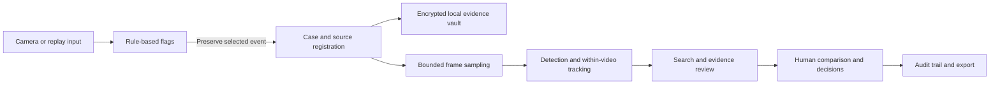

<div align="center">

# ◈ FedSight

### Video-investigation research prototype

**A local, human-in-the-loop workbench for exploring recorded video, camera activity, and uncertain movement between views.**

[Prototype status](#prototype-status) · [What works](#what-works-today) · [Architecture](#architecture) · [Run locally](#run-locally) · [Roadmap](#roadmap-to-a-main-application)

</div>

---

> [!IMPORTANT]
> **FedSight is an exploratory prototype, not the finished application.** This repository tests selected workflows and technical building blocks on a single workstation. It has not been validated for production surveillance, identity recognition, autonomous decision-making, legal evidence handling, or safety-critical use.

## Why I built it

Video review becomes difficult when useful moments are spread across recordings, cameras, and time. FedSight explores whether one local interface can help a reviewer preserve source material, inspect sampled detections, compare possible cross-camera appearances, reason about gaps, and document decisions without presenting model output as certainty.

The project is deliberately framed around **reviewable evidence and uncertainty**. A detection, similarity score, inferred route, or alert is a lead to inspect—not proof of identity, intent, or an event.

## What works today

FedSight currently includes:

- case creation and local evidence registration;
- SHA-256 hashing, encrypted asset storage, and an HMAC-linked audit trail;
- bounded video sampling with object detection and within-video tracking;
- source-linked video review and search;
- **ThreadSight**, a human review flow for possible appearance links;
- **BlindSight**, an experimental view of routes and unobserved intervals;
- local camera/replay inputs and rule-based event flags;
- synthetic walkthrough data for demonstrating the interface without real people or recordings;
- tests for core security and evidence-integrity behavior.

The use-case examples below are actual outputs generated from trimmed CITIC-MTMC
research-dataset clips. The interface screenshots use synthetic or empty-site data.
Neither set is measured benchmark performance.

### Real-video pipeline examples

#### 1. Recorded-video detection



**HallSeg sequence.** These panels were selected from a fixed two-second scan of
the 60-second clip to show both a detection and a short multi-person moment. Boxes
and confidence values are raw YOLO11n outputs, not verified identities or ground truth.

#### 2. Source-linked video review



**Recorded-review sequence.** Three source timestamps show the sampled detector
output changing as a person moves through the corridor. The lower-confidence box
also illustrates why a reviewer must inspect the original frames rather than rely
on a count alone.

#### 3. Within-camera tracking



**Local track trail.** FedSight's portable motion/IoU fallback associated sampled
detections during the first six seconds. The local track number groups observations
inside this clip; it is not a person identity. Windows Application Control blocked
the optional native LAP dependency during this run, so the recorded fallback was used.

#### 4. Multi-camera review



**Same-time multi-camera sample.** HallWide and PC at 29 seconds show how the
prototype can ingest different viewpoints. The boxes do not claim that people in
the two views are the same person; cross-camera association requires separate
features, timing constraints, and human review.

#### 5. Spatial projection



**Calibrated ground-plane example.** Detection footpoints from HallSeg at three
seconds are projected onto the published floor map using the dataset's four-point
planar homography calibration. The result depends on calibration accuracy and a
ground-plane assumption; a plausible location does not establish identity.

#### 6. Replay and rule triage



**Review-zone example.** A configured region is evaluated against sampled
detections during replay. The resulting count is a candidate flag for a person to
review, not an automated intrusion or intent conclusion. Physical live-camera
performance still depends on the camera, workstation and stream conditions.

Source: A. Carro-Lagoa et al., **CITIC-MTMC**, capture 1, trimmed to 60 seconds
for this prototype. Dataset and derived frames are used under
[CC BY-NC-SA 4.0](https://creativecommons.org/licenses/by-nc-sa/4.0/).
See the [dataset repository](https://github.com/GTEC-UDC/citic-mtmc-dataset)
and [dataset DOI](https://doi.org/10.5281/zenodo.17511785). All generated images
are derived examples under the same CC BY-NC-SA 4.0 terms.

### Interface walkthrough

<details open>
<summary><strong>Case overview</strong></summary>


</details>

<details>
<summary><strong>ThreadSight review</strong></summary>


</details>

<details>
<summary><strong>BlindSight</strong></summary>


</details>

<details>
<summary><strong>Investigator</strong></summary>



</details>

<details>
<summary><strong>Live wall</strong></summary>



</details>

## Architecture



The main parts are:

1. **Evidence layer** — registers source files, hashes originals, encrypts selected payloads, and records audit events.
2. **Processing layer** — samples frames, runs configured detection/tracking, and stores source-linked observations.
3. **Review layer** — exposes video review, search, candidate comparison, timelines, and reviewer decisions.
4. **Reasoning experiments** — explores routes, blind intervals, spatial calibration, and optional model-assisted queries.
5. **Live prototype** — accepts configured RTSP/USB/replay sources and applies simple reviewable rules.

See the [technical guide](docs/TECHNICAL_GUIDE.md) for implementation detail and the [evaluation guide](docs/EVALUATION_GUIDE.md) for the intended evaluation approach.

## What is not claimed

This repository does **not** claim:

- reliable person identification or face recognition;
- validated accuracy across cameras, environments, or demographic groups;
- complete frame-by-frame coverage;
- autonomous conclusions about identity, intent, guilt, or risk;
- production-grade authentication, authorization, tenancy, deployment, or monitoring;
- legal admissibility or compliance with a particular jurisdiction;
- compatibility with every camera, codec, model, or workstation.

Model availability, speed, and results depend on local hardware, supplied weights, configuration, scene quality, and sampling. Optional providers may require separate credentials and usage charges.

## Run locally

### Requirements

- Windows with Python 3.11 or 3.12;
- a browser and sufficient local storage;
- separately obtained model weights where required;
- a GPU is optional, but processing may be slow on CPU.

```powershell
py -3.11 -m venv .venv
.\.venv\Scripts\python.exe -m pip install --upgrade pip
.\.venv\Scripts\python.exe -m pip install -r requirements.txt
.\.venv\Scripts\python.exe -m streamlit run app.py
```

Open [http://127.0.0.1:8501](http://127.0.0.1:8501), then choose **Overview → Load synthetic walkthrough** for the safest first look. Current processing limits are shown in the application and may change as the prototype evolves.

### Run the tests

```powershell
.\.venv\Scripts\python.exe -m pip install -r requirements-dev.txt
.\.venv\Scripts\python.exe -m pytest -q
```

The presence of tests is not a claim that every model, camera, or optional integration has been validated on every environment.

## Prototype status

The current codebase is a **single-workstation research and interface prototype**. It demonstrates how selected components can fit together, and it provides concrete code for discussing design choices, limitations, evidence integrity, uncertainty, and human review.

The **main application is still future work**. Turning this prototype into a real product would require a narrower validated use case, representative evaluation data, privacy and legal review, threat modelling, production identity and access controls, deployment architecture, observability, retention policies, incident handling, and repeated field testing.

## Roadmap to a main application

A responsible next phase would focus on:

1. defining one bounded, legitimate user problem and its success criteria;
2. building reproducible evaluation datasets and reporting failure cases;
3. replacing prototype assumptions with tested service boundaries and access controls;
4. adding privacy, retention, consent, deletion, and operator-governance workflows;
5. validating camera/model performance under representative conditions;
6. piloting with trained reviewers before considering broader deployment.

## Responsible use

Use only synthetic data or recordings you are lawfully permitted to process. Keep a human reviewer responsible for every consequential interpretation. Do not use this prototype for covert monitoring, biometric identification, automated enforcement, or decisions affecting a person's rights or opportunities.

Read [RESPONSIBLE_USE.md](RESPONSIBLE_USE.md) before working with non-synthetic material. Model weights, recordings, credentials, keys, databases, and local case data are excluded from version control.

## Repository map

- `app.py` — Streamlit entry point
- `fedsight/` — core application services
- `tests/` — automated tests
- `docs/` — technical, evaluation, and implementation notes
- `.env.example` — configuration placeholders; never commit real credentials

## Licensing note

This public repository is shared for portfolio review and technical discussion; see [LICENSE](LICENSE). Third-party packages, models, and datasets retain their own terms. In particular, review Ultralytics licensing and the terms of any separately supplied weights before use or redistribution.
