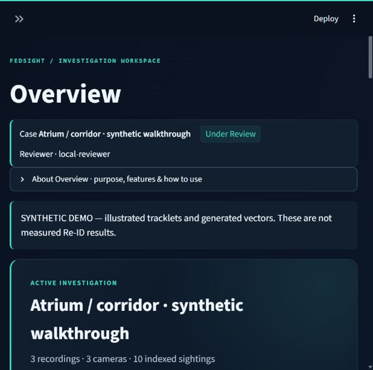
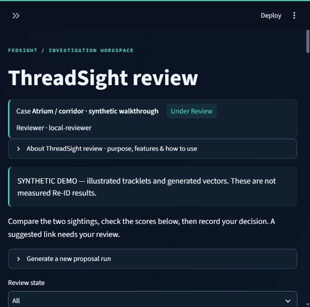
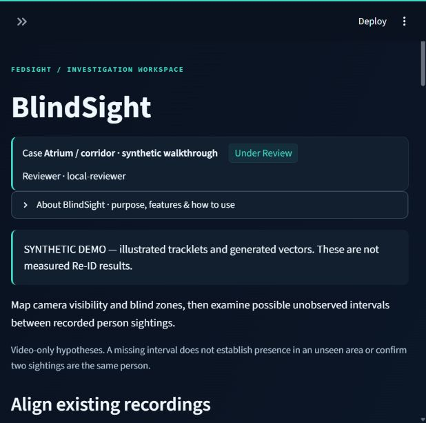
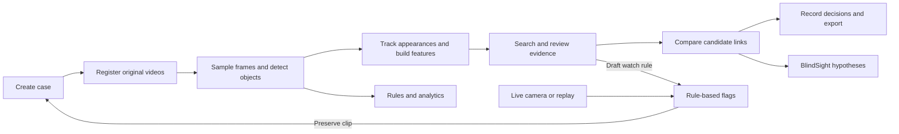

<div align="center">

# ◈ FedSight

### Intelligence Workbench

**A local prototype for exploring video evidence, camera activity, and uncertain movement between views.**

[Getting started](#getting-started) · [How it works](#how-it-works) · [Workspaces](#workspaces) · [Live cameras](#live-cameras) · [Project status](#project-status)

</div>

---


FedSight brings recorded-video investigation and live camera monitoring into one Streamlit workbench. Upload footage to a case, index visible appearances, investigate a moment and review suggested links between cameras. Switch to Live mode to monitor configured camera streams and review rule-based flags.

It is an **early research prototype**. Results are leads for a person to review alongside the original footage. Detection, visual similarity, inferred movement and alerts are subject to error. They do not establish identity or intent.

## The workbench

| Case investigation | Live operations |
| --- | --- |
| Preserve recordings, search sightings, compare appearances, inspect timelines and document decisions. | View camera feeds, configure rules, inspect alerts and preserve selected events in a case. |

<details open>
<summary><strong>Case overview</strong> · sources, case status and next steps</summary>



</details>

<details>
<summary><strong>ThreadSight review</strong> · compare candidate appearances</summary>



</details>

<details>
<summary><strong>BlindSight</strong> · explore coverage and unobserved intervals</summary>



</details>

<details>
<summary><strong>Investigator</strong> · ask questions about a case</summary>


</details>

<details>
<summary><strong>Live wall</strong> · connect cameras or replay recordings</summary>


</details>

Screenshots use the built-in synthetic walkthrough or an empty live site. Synthetic appearances and vectors are illustrations, not measured model performance.

## How it works



1. **Register evidence.** Create a case, upload supported footage and optionally assign each recording to a camera. FedSight records a SHA-256 hash and stores original assets in its encrypted vault.
2. **Process footage.** YOLO detects selected object categories in sampled frames. A within-video tracker groups detections into tracklets, and the pipeline records previews, approximate attributes and motion. Frame sampling means some events or appearances can be missed.
3. **Investigate.** Search indexed case records or ask Investigator about sightings, events and timelines. Evidence cards link back to a recording and time. Optional vision providers and local models depend on separate configuration and availability.
4. **Compare and review.** ThreadSight proposes appearance links. The reviewer inspects both sides, timing and available camera routes before recording a decision. The scores are not identity probabilities.
5. **Explore gaps and patterns.** BlindSight uses configured visibility, portals, timing and routes to present hypotheses about unobserved intervals. Spatial intelligence can project tracks onto a floor plan after calibration. Analytics summarises sampled activity and movement.
6. **Monitor and preserve.** Live mode supports configured RTSP cameras, local USB cameras and replay videos. Rules can flag observed conditions. A reviewer can preserve available buffered footage and metadata in a case.

## Getting started

### Requirements

- Windows with Python 3.11 or 3.12. A GPU is optional and video processing can be slow on CPU.
- A browser and enough storage for your local evidence and dependencies.
- Install the project dependencies below. Model weights and sample recordings are not included in this repository.

### Install and run on Windows

Open PowerShell in the project folder:

```powershell
py -3.11 -m venv .venv
.\.venv\Scripts\python.exe -m pip install --upgrade pip
.\.venv\Scripts\python.exe -m pip install -r requirements.txt
.\.venv\Scripts\python.exe -m streamlit run app.py
```

Open [http://127.0.0.1:8501](http://127.0.0.1:8501). The Windows launcher `run_windows.bat` can also start an existing environment. If port 8501 is in use, open the existing local app or stop the other process before starting a new one.

For a first look, use **Overview → Load synthetic walkthrough**. The walkthrough illustrates the review workflow without requiring your own recordings. Its sources are synthetic, so use a separate case for actual video.

### Process your own recording

1. In **Overview**, create a case. Open **Evidence & processing** and register a supported video.
2. Choose the detector, tracker and processing scope, then click **Process videos**. A local YOLO checkpoint is required. Depending on your setup, model weights may need to be obtained separately.
3. Open **Video review** to inspect the recording and sampled overlays. Use **FedSight Investigator** or **Search & digest** to find sightings.
4. Assign cameras and add routes when known. Use **ThreadSight review** to compare candidate pairs and record your decision.

The processing configuration currently limits input to supported videos up to 200 MB and five minutes per recording. Sampling is bounded. See the app for the current limits and settings.

## Workspaces

| Workspace | Purpose |
| --- | --- |
| **Overview & Cases** | Create, select and manage investigations and see case activity. |
| **Evidence & processing** | Register originals, assign cameras, configure detection and monitor jobs. |
| **Video review** | Inspect recordings, tracklets, overlays and source timestamps. |
| **ThreadSight review** | Compare candidate appearance links and record human decisions. |
| **FedSight Investigator** | Ask case-scoped questions and inspect source-linked evidence. |
| **Camera & Spatial intelligence** | Configure camera connectivity and calibrate image positions to a floor plan. |
| **BlindSight** | Examine possible routes and gaps between observations. |
| **Rules, Analytics & Timeline** | Review activity flags, trends, events and evidence relationships. |
| **Live wall & Live respond** | Monitor configured streams and triage rule flags. |
| **Evaluation & Integrity** | Explore evaluation tools, evidence verification and audit history. |

## Live cameras

In **LIVE → Camera intelligence → Connect a camera or replay**, select **RTSP camera**, enter the camera's RTSP address, choose or name a camera and select **Connect and start**. Open **Live wall** and check **System health** for the stream state. RTSP paths vary by device. Never commit camera credentials to the repository.

Live capture runs in background workers with a bounded frame queue and a rolling encrypted buffer. Rule events, review actions and case handoffs are recorded in the audit chain. Replay streams are labelled as simulated. Physical camera compatibility and achievable processing speed depend on the device and workstation.

## Models and search

- **Detection and tracking** use YOLO with the selected tracker. Availability of tracker dependencies determines which configurations work locally.
- **Person appearance** uses OSNet-compatible features. Without a suitable person Re-ID checkpoint, the default feature baseline is not a trained person Re-ID model.
- **Open-vocabulary search** can use local MobileCLIP weights and optional dependencies from `requirements-semantic.txt`. It ranks indexed previews and requires separately supplied weights.
- **Investigator** includes local tools and optional configured model providers. External providers may require credentials and usage charges. ChatGPT subscriptions and API access have separate arrangements.

Model weights, camera recordings, credentials and case databases are excluded from version control. Check the terms of each model, dataset and dependency before use or redistribution.

## Project status

FedSight is a single-workstation prototype with a local Streamlit UI. It is intended for experimentation and human review. It does not provide production authentication, enterprise deployment, validated identity recognition or a complete frame-by-frame index. Floor-plan analysis depends on camera calibration and timing quality. Live RF/CSI sensing is future work.

Local evidence is encrypted and changes are recorded in an HMAC audit chain. Reviewer names are local attribution labels. Protect and back up encryption keys separately. Losing them makes associated encrypted evidence unreadable. Exported case bundles may contain plaintext evidence.

## Development

```powershell
.\.venv\Scripts\python.exe -m pip install -r requirements-dev.txt
.\.venv\Scripts\python.exe -m pytest -q
```

The application entry point is `app.py`. Core services live in `fedsight/`, tests in `tests/`, and additional setup and evaluation notes in `docs/`. See the [technical guide](docs/TECHNICAL_GUIDE.md) and [evaluation guide](docs/EVALUATION_GUIDE.md) for more detail.

Ultralytics licensing depends on how its software is used. Review its [licensing terms](https://www.ultralytics.com/license) and the licences of any models or datasets before redistribution.
