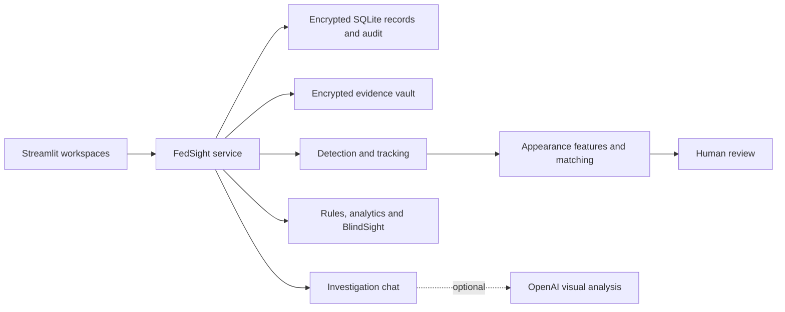
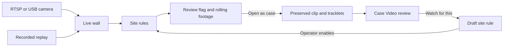

# FedSight — Intelligence Workbench

FedSight is a local, human-supervised cross-video appearance-linkage workbench.
The original YOLO → tracker → OSNet pipeline now sits inside a persistent case
workflow with camera reasoning, explainable proposals, encrypted evidence, review
history, evaluation tools and reproducible exports.

## Start here

On this workstation, run `run_windows.bat`, then open http://127.0.0.1:8501.
Choose **Load synthetic walkthrough** on Overview to explore the full application
without videos, a GPU, or downloaded Re-ID weights. The demo uses illustrated
tracklets and generated vectors; it is not an accuracy benchmark.

For a fresh environment (Python 3.11/3.12):

```powershell
py -3.12 -m venv .venv
.venv\Scripts\python.exe -m pip install --upgrade pip
.venv\Scripts\python.exe -m pip install -r requirements.txt
.venv\Scripts\python.exe -m pip check
.venv\Scripts\python.exe -m streamlit run app.py --server.address 127.0.0.1
```

`requirements-core.txt` is sufficient for the synthetic workbench and evaluation;
`requirements.txt` adds real video inference. `requirements-dev.txt` adds tests and
optional integrations. Do not install both OpenCV GUI and headless distributions.
Use `requirements-lock.txt` to reproduce the tested Windows environment when present;
GPU installations may need a platform-specific PyTorch wheel instead.

## Workspaces

## Architecture



The recorded-video pipeline preserves the original SHA-256, then performs
bounded frame sampling, YOLO detection, within-clip tracking, rough appearance
and motion features, OSNet person embeddings, candidate indexing, and optional
rule evaluation and annotated-clip rendering. Sampled track coordinates are
persisted with each tracklet. This is not yet a complete frame-by-frame index.

### Overlay legend

- Cyan: person tracklet; orange: vehicle; yellow: bag detection.
- Red zone outline: a currently visible tracklet centre is inside a configured zone.
- Trails connect recent sampled centres. Boxes between nearby samples are interpolated.
- HUD counts are visible indexed tracklets in the current frame, not unique-person totals.
- `VALIDATED` means a visible tracklet belongs to a human-accepted link; it does not identify a person.
- The bottom timestamp is clip-relative, with corrected UTC when an anchor is configured.

Annotated clips are silent. When available, imageio-ffmpeg converts them to
H.264; otherwise the local MP4 encoder is used. Rules can use rectangular zones
or manually entered normalized polygons. Create an offline synthetic sample with
`.venv\Scripts\python.exe scripts\create_sample_video.py` on Windows or
`python scripts/create_sample_video.py` on Linux.

## Screenshots

Screenshots of the synthetic walkthrough are included in the repository README.

### REVIEW · Find and verify recorded evidence

Process uploaded footage with person and optional vehicle detection. Person
tracklets use OSNet features for cross-camera appearance proposals; vehicle
tracklets use an untrained colour descriptor for visual search. Search by
source, category, vehicle subtype, time, approximate colour, rough upper/lower
clothing colour, motion and quality. Optional YOLO bag detections and approximate
person/bag proximity are available; a hat classifier is not included. Inspect
source-time context, review candidates, bookmark tracklets, download a
time-labelled preview reel and export a verifiable case bundle. The reel
shows sightings sequentially; it does not combine different moments into one scene.

### RESPOND · Monitor and triage

Create zone-entry, line-crossing, stationary dwell, crowd-threshold,
person-count, image-speed, image-direction and unattended-object candidate
rules in **Rules & events**. Unattended-object candidates require a stationary
bag track and no nearby person in sampled detections, so missed detections can
produce false flags. Crowd thresholds can be restricted to a normalized rectangle.
Rules can be enabled or disabled with an audited state history. Speed and
direction use image coordinates and are sensitive to camera perspective.
Batch evaluation works on sampled recordings. **Live respond** reviews site
flags from background camera workers. Use the live rules log to export flags
as CSV. Camera workers can be paused when switching to Case mode. See [Live vs Case mode](#live-vs-case-mode) for setup and handoffs.

### RESEARCH · Describe observed activity

**Analytics** offers source/category filters, saved dashboard presets,
clip-relative activity trends, stationary visibility durations, common
image-plane entry/exit paths and per-camera motion density. Values describe
sampled tracklets and can be affected by missed detections or split tracks.

### BlindSight · Investigate unseen intervals

**BlindSight** is a video-only hypothesis workflow. Define schematic visible,
blind, obstacle and occlusion rectangles. For each blind zone, mark image-plane
exit and entry portals for the relevant cameras. Register camera transitions
and use **Align existing recordings** to assign already uploaded sources to
cameras and document their clock offsets. These alignment records preserve
the original source metadata. Then generate hypotheses from ThreadSight
person proposals. BlindSight stores the last/first sampled sightings,
uncertain UTC gap, candidate zones, route alternatives, supporting and
contradictory evidence, competing appearance proposals, manual secondary
clues, investigator decisions and source/configuration IDs. Candidate density
on the map counts hypotheses, not observed occupancy.

Archived sensor ingestion and live RF/CSI sensing are deferred. Live coverage
uses camera observations. Unaligned clocks, missing portals, rejected
links and conflicting travel times remain explicit unknowns or conflicts;
BlindSight never asserts an unseen person's location or identity.

### FedSight Investigator · Ask about the case

Ask about recorded alerts, appearances, timelines, line-event counts, or
BlindSight hypotheses. The assistant searches only the active case, returns
source-linked evidence and persists conversation messages and feedback in the
encrypted, audited case store. Select **Evidence used** to inspect the tool
and its results. Evidence cards can open Video review at the relevant moment,
bookmark a tracklet, or open a matching proposal in ThreadSight.

The built-in engine works offline. The default optional planner connects to
Ollama on `127.0.0.1:11434` using `llama3.1:8b`; install Ollama and pull the
model separately. If it is unavailable, the app automatically uses the
offline engine. Optional planners support `GROQ_API_KEY`, `GEMINI_API_KEY`,
`OPENROUTER_API_KEY`, or `OPENAI_API_KEY` from the environment, Streamlit
secrets, or the session key field. Install `requirements-ai.txt` for the
client library. Selecting a cloud provider requires an in-app checkbox before
your question and camera labels are sent. Case evidence and thumbnails remain
local. These providers select a tool; answers and citations are constructed
from local records. Model and free-tier availability can change.

For a wall-clock query, supply a date and UTC offset, for example
`after 2026-01-01T10:01:00Z`. Unaligned recordings are excluded from UTC
filters, and overlapping clock uncertainty is included. Appearance search
uses existing indexed tracklet descriptors, not CLIP text-to-image search.
Add a tool in `fedsight/investigator.py`, add an allowlisted schema in
`fedsight/investigator_engines.py`, and cover it with tests. Run the 25-query
synthetic check with `make eval-chat` or `python scripts/eval_investigator.py`.

## Detailed pages

- **Overview:** cases, collection/retention notes, state transitions and case notes.
- **Evidence & processing:** multi-video registration, immutable encrypted originals,
  clock metadata, per-source jobs, detector/tracker/OSNet settings and provenance.
- **Video review:** source player, clip-time density and event markers, sampled
  tracklet overlays on a selected original frame, grid/list/timeline views, and
  generated silent annotated clips. Derived clips are encrypted
  in the evidence vault and included in case bundles with SHA-256 hashes. Overlays
  interpolate nearby saved detections and do not track every video frame; browser
  support for the local MP4 encoder varies.
- **Cases:** bookmarked tracklets and proposals, case notes, original video
  context, and a verified report and evidence bundle.
- **ThreadSight review:** side-by-side previews and original context playback,
  raw cosine, crop quality, competitor margins, AICE, camera routes, calibrated
  classifier estimates when a trained artifact is selected, accept/reject/defer.
- **Search & digest:** source/time/colour/motion/quality filters, bookmarks and
  verified PDF/JSON/CSV/thumbnail exports with original hashes and exact time ranges.
- **Timeline & graph:** corrected UTC or explicitly source-relative lanes,
  human-confirmed appearance groups, contradictory review detection and read-only
  question templates; optional Neo4j projection.
- **Camera intelligence:** camera registry, relative map and directed travel-time
  bounds with configuration provenance and uncertain clock reasoning.
- **Rules & events:** offline stationary-duration, zone-entry, line-crossing,
  crowd and count flags, with human event review.
- **Live respond** displays incoming rule flags, footage, review actions and case handoffs.
- **BlindSight:** coverage maps, boundary portals, persisted gap hypotheses,
  supporting/conflicting evidence and investigator review.
- **FedSight Investigator:** case-scoped event and tracklet tools, evidence
  cards, audited conversations, and optional provider-based tool selection.
- **Analytics:** review coverage, configurable activity, stationary duration,
  common paths and sampled image-plane motion density.
- **Evaluation lab:** leakage checks, logistic/gradient-boosting/MLP comparison,
  separate calibration and threshold selection, held-out metrics/failure examples,
  synthetic datasets and in-process FedAvg/FedProx research simulation.
- **Integrity & audit:** AES-256-GCM asset verification, HMAC-SHA3-256 audit and record
  checks, external checkpoints and persistent replay controls.

## First real case

1. Create a case and record collection/retention notes.
2. Register cameras and directed measured transitions if available.
3. Upload short consented recordings (50 MB each; at most 32 per case). If clocks
   are known, upload each recording with its own offset-aware timestamp, correction,
   uncertainty and alignment provenance. Unknown times stay clip-relative.
   Videos up to five minutes are accepted. The sampler adjusts spacing to cover
   the recording within the selected frame budget; CPU processing may take minutes.
4. Choose Person and/or Vehicle in **Detect and index**. Use **Reprocess every
   source with these settings** to apply a new selection to completed videos.
   Auto tracker prefers ByteTrack and uses portable motion/IoU when native LAP is
   unavailable. The job records which tracker actually ran. Select an approved
   detector and a trusted OSNet checkpoint matching the chosen
   architecture. Default ImageNet weights are not trained person-Re-ID weights.
5. Process pending sources. Processing runs in a background thread while the app
   remains open. Progress and cancellation appear on the processing page. Cancellation
   is checked between frames and model stages; the current unfinished source is
   discarded while completed sources remain available. Choose pending / failed
   sources to restart an unfinished source from the beginning. An interrupted app
   restart needs explicit recovery after the original worker has stopped.
6. Review proposals and record reasons. No model score automatically confirms a link.
7. Inspect the timeline and exact evidence digest, verify integrity, then export.

Cosine, dual-softmax confidence, quality and AICE are not calibrated probabilities.
A calibrated pair classifier still needs representative real held-out data before
its estimates can be trusted. Without labelled footage, no real accuracy is claimed.

## Persistence and keys

Data defaults to `data/workbench/`; the old `data/fedsight_reviews.sqlite3` is left
intact. A local backup may be available in `backups/`.
Legacy reviews are not silently mapped onto new source/track UUIDs.

Original video bytes, preview assets and database record payloads are encrypted.
Opaque record IDs and audit metadata remain visible. Separate encryption/audit key
files default to the ignored `data/workbench/keys/` directory. Set
`FEDSIGHT_KEY_DIR` to protected storage before ingesting real footage; back up the
keys separately. Losing them makes encrypted evidence unrecoverable. No key
rotation or multi-user key service is claimed.

Export audit checkpoints and keep them outside the evidence store. A retained
checkpoint detects tail truncation; a chain stored beside a compromised key does
not. Downloaded case bundles are plaintext. This dashboard is bound to loopback,
uses self-reported reviewer names, and is not a production multi-user service.

## Commands and tests

```powershell
.venv\Scripts\python.exe -m pip install -r requirements-dev.txt
.venv\Scripts\python.exe -m pytest -q --basetemp tmp/pytest-local
.venv\Scripts\python.exe -m fedsight demo
.venv\Scripts\python.exe -m fedsight verify
.venv\Scripts\python.exe -m fedsight sample-dataset pairs.json
.venv\Scripts\python.exe -m fedsight evaluate pairs.json experiment.json
.venv\Scripts\python.exe -m fedsight export CASE_ID case-export.zip
```

The sample dataset is synthetic. Read `docs/EVALUATION_GUIDE.md` before collecting
and splitting real data. Failed integrity checks block case bundle export.

## Optional integrations

Install `requirements-integrations.txt`. Neo4j sync is explicitly triggered from
Timeline & graph using `NEO4J_URI`, `NEO4J_USER`, `NEO4J_PASSWORD`. The local SQLite
store stays authoritative; the Neo4j projection contains decrypted metadata and
must have its own access controls. A running server is needed to validate sync.

For the local API, set `FEDSIGHT_API_TOKEN` to a random secret of at least 32
characters, optionally set `FEDSIGHT_API_ACTOR`, and run:

```powershell
.venv\Scripts\python.exe -m uvicorn fedsight.api:create_app --factory --host 127.0.0.1 --port 8000
```

All case/review routes require the bearer token. `/health` exposes only status and
version. This is a single-trust-domain API, not a replacement for multi-user RBAC.
See `.env.example`; the application does not automatically load `.env` files.

## Scope and next research gates

See `docs/IMPLEMENTATION_STATUS.md` for the complete roadmap mapping and remaining
work. Production login/RBAC, distributed queues, ONVIF/VMS integration, calibrated
floorplan occupancy, trained attribute models, video montage rendering, anomaly
autoencoder training and Flower networking remain future integrations. The roadmap
also defers face recognition, CKKS, GAT/TGN and broad enterprise-VMS replication.

Ultralytics YOLO is available under AGPL-3.0 or an Enterprise licence; see the
[Ultralytics licensing page](https://www.ultralytics.com/license). Review the licences of Ultralytics and
any pretrained checkpoint before redistribution. This build is a research workbench,
not a claim of legal admissibility, real-world identity, or production readiness.


## Live vs Case mode

Open [Live operations](http://127.0.0.1:8501/?mode=live&page=live-wall) or [Case investigation](http://127.0.0.1:8501/?mode=case&page=overview). The sidebar switch remembers the last workspace in each mode for the browser session. Copy the URL to open the current workspace again. Press **M** outside an input to switch modes.



| Mode | Workspaces |
| --- | --- |
| Live operations | Live wall, Live respond, Rules & events, Camera intelligence, Spatial intelligence, BlindSight, Live analytics, Live Investigator, System health |
| Case investigation | Overview, Evidence & processing, Video review, ThreadSight review, Search & digest, FedSight Investigator, Cases, Timeline & graph, Analytics, Evaluation lab, Integrity & audit |
| Additional case tools | Camera intelligence, Spatial intelligence, BlindSight with recording alignment, Rules & events for recorded evidence |

**Try the replay.** In Live wall, choose a site and click **Start demo streams**. FedSight can loop locally supplied EPFL demo recordings and enable a person-visible rule for each demo camera. Demo recordings are not included in the repository. Local YOLO weights load on the first analyzed frame. Choose **Focus** to inspect a camera. In **Live respond**, open a flag and choose **Open as case**. A ten-second continuous sampled interval must be available, so allow the stream to run for at least ten seconds. Each source remains labelled as a replay in the handoff.

**Connect a camera.** In **Camera intelligence → Connect a camera or replay**, select RTSP camera, enter the endpoint, choose or register its mapped camera, and click **Connect and start**. USB accepts a local device index. Uploaded video loops as a replay. Enable **Privacy mask all pixels** at connection time for a full-scene mosaic on subsequent footage and exports. Open **System health** to stop or restart a configured camera. Stream configurations are stored encrypted. After restarting the app process, start the desired sources again.

**Review a flag.** Alert state changes and evidence preservation are recorded in the workstation’s HMAC audit chain. Live Investigator can answer “Any intrusions in the last 10 minutes?” from stored zone flags or “Who is in the Exit zone now?” from current sampled tracks and a configured Exit zone. It reports local track IDs and observations. A detector miss, duplicated track or delayed frame can affect counts. BlindSight requires a mapped exit portal, a configured travel window and sampled destination coverage before listing a transit hypothesis.

**Storage and time.** Each site defaults to 15 minutes or 0.25 GiB of rolling encrypted footage, whichever fills first. Adjust both in **System health**. Retention expires buffered footage while the service is running. Event records, case evidence and configured replay source files have separate lifetimes. Heatmaps retain a day of aggregate samples. Times in operations are workstation capture UTC. Replay timestamps describe the replay session. Preserved clips sample the captured frames at 4 FPS with their observed timestamps burned in. Processing can skip frames under load. Local streams need the video dependencies, local `yolo11n.pt` and FFmpeg or `imageio-ffmpeg` for case clips.

